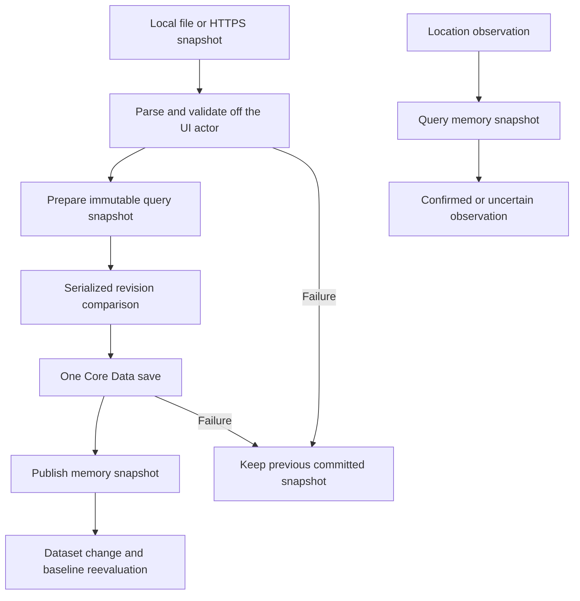

# System flows

The following is the intended flow from specification section 3 and
Sources/SheepFence/Storage/README.md, not an implemented or tested pipeline.

Only the client and store signatures exist today (GeofenceClient.swift:20–24;
SnapshotStore.swift:6–7). There is no implemented control flow to prove atomicity.
